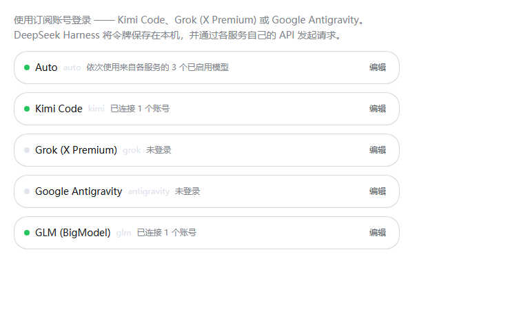
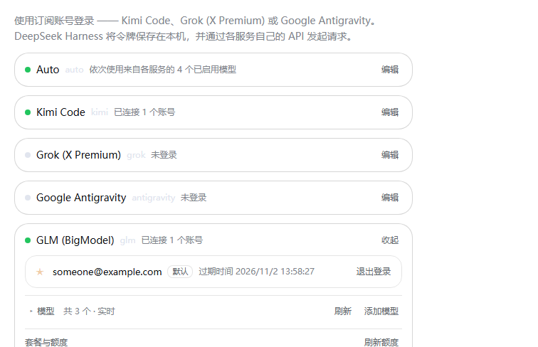
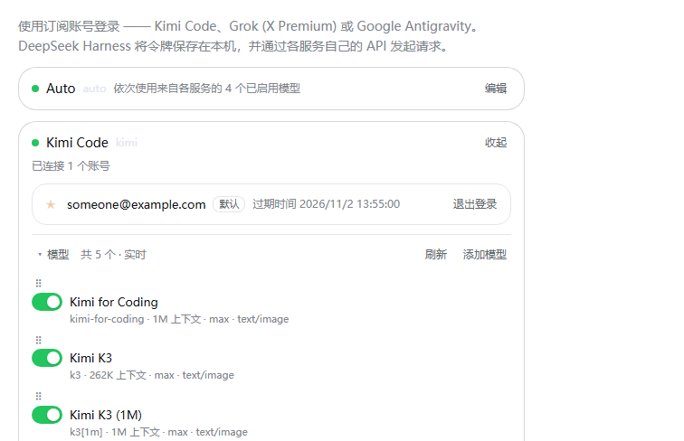

[English](README.md) · [简体中文](README.zh.md)

# dsh-plugin-subscription-oauth

[](https://dsh-plugin.org/plugins/EricFL1998/dsh-subscription-oauth)
[](https://www.npmjs.com/package/dsh-plugin-subscription-oauth)
[](LICENSE)

**Use the AI subscriptions you already pay for as LLM providers in DeepSeek
Harness — no API key.** Sign in once per provider from **Settings →
Subscriptions** (订阅) and that account's models join the session model picker,
with its plan quota shown next to the connection.

```sh
dsh plugin --profile web add dsh-plugin-subscription-oauth
```

The same package installs straight from the repository, which needs no registry:

```sh
dsh plugin --profile web add github:EricFL1998/dsh-subscription-oauth
```

| | |
| --- | --- |
| **Capability** | 模型与推理 / Model & inference — it registers LLM provider routes |
| **Licence** | [MIT](LICENSE) |
| **Built for** | DeepSeek Harness `0.2.0-rc.2` (`@deepseek-ai/dsh-llm`), Node ≥ 20 |
| **Platforms** | Windows, macOS and Linux; nothing platform-specific beyond Node itself |
| **Accounts** | your own subscriptions only — credentials stay on your machine |
| **Network** | the providers' own hosts and the OAuth endpoints listed below; no telemetry, no third-party relay |

| Route | Provider | Login | Wire |
| --- | --- | --- | --- |
| `kimi` | Kimi Code | OAuth **device flow** (RFC 8628) | OpenAI **Responses** — `https://api.kimi.com/coding/v1/responses` |
| `grok` | Grok (X Premium) | OIDC **authorization code + PKCE** on a loopback callback | OpenAI **Responses** — `https://api.x.ai/v1/responses` |
| `antigravity` | Google Antigravity | Google **authorization code + PKCE** (`/oauth-callback`) plus Cloud AI Companion project discovery | Cloud Code Assist `v1internal` — `streamGenerateContent?alt=sse` |
| `glm` | GLM (BigModel) | ZCode's **browser sign-in with a polled flow** (China region) | OpenAI **Responses** — `https://open.bigmodel.cn/api/coding/paas/v4/responses` |
| `ark` | Volcengine Ark | Volcengine **SSO** (authorization code + PKCE on a loopback callback) | OpenAI **Responses** — `https://ark.cn-beijing.volces.com/api/coding/v3/responses` |
| `auto` | Auto | none — it holds no account of its own | delegates to whichever route owns the model it picks |

The Kimi device flow is the one `opencodex` uses; the Grok flow is the one its
CLI uses (`auth.x.ai` discovery, client `b1a00492-…`, port `56121`, scope
`grok-cli:access`); the Antigravity flow is Google's desktop OAuth client
(`accounts.google.com`, port `51121`, scopes including `cclog` and
`experimentsandconfigs`), with the account's project discovered through
`loadCodeAssist`.

**GLM signs in the way ZCode does**, not with an API key: the plugin asks
`zcode.z.ai` for a login flow, opens `bigmodel.cn/login` in the browser, and polls
the flow until the subscription's tokens come back. Nothing has to receive a
`zcode://oauth/callback` redirect and no app secret is involved, because the
callback is completed server-side and the flow is authenticated by a secret the
plugin generates itself. Allowances are read from BigModel's own
`/api/monitor/usage/quota/limit`, which meters a rolling five-hour window and a
weekly one.

**Ark signs in with Volcengine SSO** (authorization code + PKCE on a loopback
callback, the flow its own CLI uses) and then has to satisfy two planes that want
different credentials. The **data plane** takes only an ordinary API key as a plain
bearer — it refuses STS credentials outright — while the **control plane**, a
different host, is signed with the temporary STS credentials that the SSO token
response carries. So a sign-in mints one API key through the control plane (reusing
a key this plugin already created, if there is one) and keeps the STS set for the
quota, which is read per subscription period and per model's free allowance.

## What it registers

| Surface | What appears |
| --- | --- |
| `ctx.llm` | the `kimi`, `grok`, `antigravity`, `glm` and `auto` provider routes (models, reasoning efforts, streaming) |
| Settings | a **Subscriptions** section: one card per provider — sign in, sign out, default account, token refresh, plan quota, model catalog, manage dialog |
| Model picker | each provider's own models, plus **`auto` as its own route** spanning them. Membership comes from the provider's own model list, read once and cached as that route's table (`~/.dsh/plugins/kimi-oauth/model-catalog.json`), so the picker never spends a request and a release or retirement server-side needs no plugin update. Kimi serves `kimi-for-coding`, `k3` (1M) and `k3-256k`; Grok adds whatever its live catalog reports on top of `grok-4.6`/`grok-4.5`; Antigravity lists the agent-callable subset of what its endpoint reports (`fetchAvailableModels`), filtering out tabs, commit-message and transcription surfaces; GLM adds whatever its coding host lists on top of the `glm-5.3` family |

Credentials live at `~/.dsh/plugins/kimi-oauth/auth.json` (mode `0600`,
written atomically, one section per provider). The directory keeps the name this
plugin had when it served Kimi Code alone: it holds **live logins**, so it is left
in place rather than renamed, and every profile that mounted the earlier version
finds its accounts exactly where it left them. This machine's Kimi device id
lives beside it in `kimi-device-id`; it is stable across restarts, because the
service correlates usage to it.

### Token lifetimes, and why the card may say "expired"

Kimi Code access tokens live **15 minutes**; the refresh token lives **30 days**.
Grok access tokens are similar. Every request refreshes automatically when the
access token is within five minutes of lapsing, and the Settings card refreshes
eagerly while you are looking at it — so what it shows is the live expiry, and
"token expired" appears only when a refresh genuinely failed and the account
needs a new sign-in. Access-token expiry is normal and does not mean the login
is gone.

## Settings page

| Every route folded | A subscription card open | A card with its catalog |
| --- | --- | --- |
|  |  |  |

The page leads with **`auto`**, the way to reach every other route at once; the
routes it stands in for follow in the order they were configured. Each route is one
**folded row** — status dot, name, route key, a one-line summary of the connection,
and an **Edit** button — so the section reads as a list of providers and opens one
on demand. **Every visit starts folded** — an open card is a gesture within one
visit, not a stored setting — so re-opening Settings always shows the same compact
list. Inside an open card are the
account rows (★ sets the default account, `退出登录`/`Sign out` removes one), the
model catalog, and the plan quota. Controls follow the host's own settings-form
vocabulary — a 6 px radius (`--dsw-radius-sm`), a transparent fill, a hairline
border, and the theme's hover/active/focus tokens — declared in one scoped
stylesheet, so the page keeps that look instead of falling back to the browser's
default button chrome.

The **Models** heading is its own disclosure, **folded on every visit** too: click it to open the
catalog. **Each model has its own switch** (a toggle,
not a checkbox), which decides whether the session model picker offers it. The
choice is stored on the host (`~/.dsh/plugins/kimi-oauth/preferences.json`) as a
hidden list, so it survives restarts and every session sees it; a model added by a
later catalog refresh appears automatically rather than arriving hidden. A hidden
model is listed dimmed and stays **resolvable** — an existing session that already
selected it keeps working — so hiding is a picker-visibility choice, not a
revocation. `· 已隐藏 N 个` in the header counts the hidden ones.

**Add model** publishes an id this build has never heard of, so a model released
after the plugin was built is usable at once. The id is checked for shape, not
against a list — the endpoint is the only authority on what it serves — and it is
stored per route, published with conservative metadata, and listed with a `×` so a
typo can be removed again. **Drag a row** by its ⠿ grip (or press ↑ / ↓ while the
grip is focused) to re-order the list; that order is what the picker follows for
that route.

**`auto` is a provider of its own** (route `auto`), not a model inside each one: it
stands in for the enabled models of *every* provider the harness serves in one list,
each row badged with the provider that owns it. That includes the routes this plugin
registers **and** the ones it does not — the built-in DeepSeek providers and any
provider you added yourself — because it enumerates the harness roster
(`ctx.llm.listProviders()` / `listModels()`) and dispatches through it rather than
looking only at its own routes. It leads both the Settings section and the model
picker, because it is the one entry that reaches every route. It has no account, so
its card offers no connect or manage — only the list. A switch takes a model out of
Auto **without** hiding it from the picker, drag re-orders what Auto tries first, and
the arrangement is stored separately (`auto.order` / `auto.off`). Switch every model
off and Auto is simply not offered in the picker.

A provider with no signed-in account contributes no rows: `listModels` answers with
nothing until a route has a session, so signing out removes that route's models from
the picker and from Auto at the same time, and its card hides the catalog instead of
offering models that cannot be called.

Auto falls through to the next model when the provider refuses the preferred one
(renamed or gone, rate-limited, out of allowance, or a transport failure). A
concrete model id never falls back — it dispatches to exactly that model. Once a
stream has produced any output the turn belongs to that model, so a later failure
is reported instead of being papered over by a second model's text. Every fallback
is logged (`model X unavailable … falling back to Y`).

**Plan and usage** shows the subscription tier and every allowance the provider
states, with a meter and a reset time: Kimi's rolling 5-hour window, weekly window
and included credit (`GET /coding/v1/usages`); Grok's weekly included credit
(`cli-chat-proxy.grok.com/v1/billing?format=credits`, plus the plan tier from the
token's own `tier` claim); and Antigravity's buckets — Gemini and Claude, each
rolling and weekly — read from `v1internal:retrieveUserQuotaSummary` and merged
with the per-model `quotaInfo` of `fetchAvailableModels` (worst-spent model per
family, classified by id, display name and tier, so an `Opus` row counts as
Claude). Each row takes whichever of the two reports more spent, because the
summary's rolling bucket can answer "full" however much has been spent. Two
things that look like data are not: a bucket marked `disabled` states no window
(with the weekly limit spent, Google reports the five-hour one as full and
disables it, so counting it would read as a free five hours), and a per-model
`quotaInfo` that states its reset but no `remainingFraction` is a **spent**
allowance — the service drops the fraction once nothing is left. A per-model
figure whose reset is a week out is the weekly bucket, not the rolling one. A
provider that states nothing says so instead of inventing a figure.

A reset is stated by how far off it is, on every route: **minutes** within the hour
(`40 分钟后重置`), **hours** within the day (`4 小时后重置`), and the date beyond that
(`重置时间 2026/10/17 13:54`) — the count is what a reader acts on when deciding whether
there is room left, and a date is what they need when it is a week away. Because the
page re-reads the figures on a slow interval, the count follows along while it is
open.

**Manage** opens a dialog with per-account token refresh, the credential-file
path, and the resolved endpoints.

While a device authorization is pending the card shows the code, its expiry, and
the buttons to open or copy it, and the status dot turns amber. A loopback
provider (Grok) instead shows a sign-in link and waits for the browser redirect.

## Install

```sh
dsh plugin --profile web add dsh-plugin-subscription-oauth
```

`web` is the profile that serves the Settings page; use `desktop` (or any other
profile name) if that is the one you run.

The CLI forwards its arguments to pnpm, so a pinned version, a git URL and a local
path are all spelled the same way:

```sh
dsh plugin --profile web add dsh-plugin-subscription-oauth@0.2.2
dsh plugin --profile web add github:EricFL1998/dsh-subscription-oauth
dsh plugin --profile web add /path/to/dsh-plugin-subscription-oauth
```

Restart `dsh web` (or the desktop app) afterwards so the new bundle loads. A local
directory is installed as a `link:`, so afterwards `npm run build` in the checkout
is enough to publish a change; restart again to pick it up.

The host packages (`@deepseek-ai/dsh-llm` and the rest) are **optional** peers: the
harness provides them at runtime, so installing this plugin does not fetch a second
copy of the host it is running inside.

### Releasing (maintainers)

`prepublishOnly` rebuilds `lib/` — the TypeScript output plus the browser bundle — so
a published tarball can never carry a stale client:

```sh
npm version patch   # or minor/major
npm publish
```

For a headless composition that only needs the model route (no Settings page):

```sh
dsh --profile headless --patch /path/to/dsh-plugin-subscription-oauth/overlay.yml "your task"
```

where `overlay.yml` is a one-entry patch naming
`/path/to/dsh-plugin-subscription-oauth/lib/index.js`. Log in once from a web profile
first — the token file is shared.

## Hiding a built-in provider from the picker

A plugin cannot unregister another bundle's route (`ctx.llm` has no unregister
API), so hiding a built-in provider is a profile-patch change. To hide the
**DeepSeek API-key** route and its models while keeping the **DeepSeek account**
(sign-in) route:

```yaml
# $DSH_HOME/profiles/<profile>/cordis.patch.yml
- id: llm-deepseek
  name: "@deepseek-ai/dsh-llm-deepseek-api-key"
  config:
    models: []
```

`models` replaces the adapter's default catalog, so `deepseek-official` reports
no models and the picker hides the empty group (`Empty groups are hidden`); the
route stays registered, so a session that already saved one of its model ids
keeps working. Leave `llm-deepseek-account` alone to keep the account route.
Restart the profile (or let HMR reload) for the change to apply.

## Use

1. Open **Settings → Subscriptions** (订阅) and press **Connect** on the card you want.
2. Finish the sign-in the card shows: Kimi Code and (when answered) a device code
   you approve in the browser; Grok and Antigravity open a sign-in page and wait for
   the redirect. The section updates by itself while an attempt is pending.
3. Open the model picker in any session and choose a model under that provider —
   or leave it on **Auto** to let the enabled models be tried in order.

Not signed in? The provider stays out of the picker, and a request fails with
`INVALID_CREDENTIAL` pointing at the Settings page. Nothing else breaks.

Multiple accounts are supported: connect again to add another. The ★ default
account serves requests; use **Use by default** to switch.

## Config

```yaml
- id: llm-subscription-oauth
  name: dsh-plugin-subscription-oauth
  config:
    providers: [kimi, grok, antigravity]  # routes to register; all are default
    enabled: true
    discovery: true                  # consult each endpoint's live model list
    streamIdleTimeoutMs: 300000      # abandon a silent stream after this
    defaultModel: kimi-for-coding    # model the picker preselects on the Kimi route
    extraModels: []                  # Kimi ids to publish without shipped metadata
    # oauthHost: https://auth.kimi.com
    # apiBase: https://api.kimi.com/coding/v1
```

Only the Kimi route takes `oauthHost`/`apiBase`/`defaultModel`/`extraModels`: the
Grok and Antigravity endpoints are fixed by their own clients, and their model
lists come from the live catalog. Omitting a route from `providers` simply leaves
it unregistered.

`oauthHost` and `apiBase` can also come from the environment
(`KIMI_CODE_OAUTH_HOST` / `KIMI_OAUTH_HOST`, `KIMI_CODE_API_BASE` /
`KIMI_API_BASE`); an explicit config value wins. `apiBase` accepts either the
bare base or the full `.../responses` URL.

## How it works

The package is a standard DeepSeek Harness plugin: `lib/index.js` exports
`apply(ctx)`, which registers one `ctx.llm` adapter per route and mounts the
Settings section through `ctx.slots`. `lib/client.js` is the browser half — the
section itself, loaded by the harness bundle loader. Nothing runs outside the
harness process, and uninstalling the bundle removes every route it added.

**Login** is the RFC 8628 device authorization grant against
`auth.kimi.com`. The plugin requests a device code, shows it, and polls the
token endpoint with `authorization_pending` / `slow_down` / `access_denied` /
`expired_token` handling until the browser approves. Tokens are stored per
account, keyed by the `user_id` (or `sub`) claim inside Kimi's JWTs.

**Grok** signs in with the flow its own CLI uses: OIDC discovery at
`auth.x.ai`, an authorization-code exchange with PKCE on a loopback callback
(`127.0.0.1:56121/callback`), and a refresh grant that keeps the client identity.
**Antigravity** is Google's desktop OAuth client on `127.0.0.1:51121`, whose
scopes include `cloud-platform`; login is only complete once `loadCodeAssist`
reports the account's Cloud AI Companion project, because every later
`v1internal` call is scoped to it.

**Requests** carry three identity layers:

* the bearer access token, refreshed ahead of expiry (5-minute preempt) with one
  in-flight refresh shared per account;
* Kimi's `X-Msh-*` client identity (`KimiCLI/<version>`, platform, device id) —
  the service admits the request by this family;
* the harness attribution product. Because Kimi admits a request by the CLI
  product token while the harness requires its own attribution on every provider
  request, the two are joined into one RFC 9110 `User-Agent` value rather than
  sent as two competing fields.

**The wire** is OpenAI Responses: `instructions` + `input` items,
`function_call` / `function_call_output` kept adjacent (the endpoint requires
it), `stream: true`, `store: false`, `prompt_cache_key` from the session id for
cache affinity, and `reasoning.effort` mapped from the harness's effort id.
Stored reasoning is never replayed as text — the endpoint keeps a subscription
account's thinking encrypted server-side, so each turn stands on its own visible
content.

Kimi locks temperature and sampling penalties on subscription coding models, so a
caller-supplied `temperature` is dropped rather than rejected upstream.

## Troubleshooting

| Symptom | Cause |
| --- | --- |
| `<provider> login expired; sign in again…` | the refresh token was rejected; connect again |
| No models in the picker | not signed in, or the route was not re-announced — check **Settings → Subscriptions** |
| No models at all for Antigravity | the account's `fetchAvailableModels` returned nothing; the route ships no curated list, so press **Refresh** after signing in |
| `model not found` | the id is not served by your plan; use **Refresh** |
| The code card never clears | the attempt is still pending or expired; press **Cancel** and connect again |
| `model discovery failed … using the built-in catalog` | the live list was unreachable; the shipped catalog still works (Kimi and Grok ship one, Antigravity does not) |
| Rows cannot be dragged | the layout is switched off in Settings, or the drag started on the checkbox — grab the ⠿ grip |

## Security notes

### What it stores, and where

| Path | Contents | Mode |
| --- | --- | --- |
| `~/.dsh/plugins/kimi-oauth/auth.json` | one section per provider: access token, refresh token, expiry, account id, plan | `0600`, written atomically |
| `~/.dsh/plugins/kimi-oauth/preferences.json` | model visibility, your ordering, and Auto's chain — no secrets | `0600` |
| `~/.dsh/plugins/kimi-oauth/kimi-device-id` | the stable device id Kimi's API expects | `0600` |

The directory keeps the name this plugin had when it served Kimi Code alone: it
holds **live logins**, so renaming it would sign everyone out. Nothing is stored
outside `~/.dsh`, and nothing is uploaded anywhere except to the providers
themselves.

### What it talks to

| Route | Hosts contacted | Why |
| --- | --- | --- |
| `kimi` | `auth.kimi.com`, `api.kimi.com` | device-flow sign-in, then the coding API |
| `grok` | `auth.x.ai`, `api.x.ai`, `cli-chat-proxy.grok.com` | OIDC sign-in, the Responses API, the plan's credit figure |
| `antigravity` | `accounts.google.com`, `oauth2.googleapis.com`, `cloudcode-pa.googleapis.com` | Google sign-in, the account's project, then Cloud Code Assist (including its quota accounting) |
| `glm` | `bigmodel.cn`, `zcode.z.ai`, `open.bigmodel.cn` | browser sign-in brokered by ZCode, then the coding-plan API and its allowance |
| `ark` | `signin.volcengine.com`, `ark.cn-beijing.volces.com`, `ark.cn-beijing.volcengineapi.com` | Volcengine SSO, then the coding-plan API (data plane) and the signed control plane that mints the API key and reports the allowance |

There is no analytics, no update ping and no relay through anyone else's server:
every request goes to the host that owns the account. No request body, prompt or
token is ever logged.

### Boundaries worth knowing

* The token file is written with mode `0600`; only the account id, email, host,
  and device id are ever shown in the UI — never a token.
* The Kimi and GLM flows need no listener on this machine at all: Kimi polls, and
  GLM's browser callback is completed server-side by the provider. Grok and
  Antigravity hold one loopback listener **only** while a login attempt is pending,
  on `127.0.0.1:56121` and `127.0.0.1:51121`, and it is closed as soon as the
  attempt settles or lapses. A loopback destination is never proxied.
* Outbound requests honour `HTTPS_PROXY` / `HTTP_PROXY` / `ALL_PROXY` and
  `NO_PROXY`.
* Signing in authorizes this machine for that account — the provider's own consent
  screen is the consent step, and it is never completed on your behalf.
* A plugin cannot unregister another bundle's provider (`ctx.llm` has no unregister
  API), so this plugin never hides anything you had before; see
  [Hiding a built-in provider from the picker](#hiding-a-built-in-provider-from-the-picker)
  if that is what you want.
* **Known limits**: OpenAI-compatible API keys are not supported by design (this is
  a subscription plugin); GLM's flow has no refresh grant, so a lapsed sign-in asks
  you to sign in again rather than renewing silently; Antigravity ships no curated
  model list and depends on its endpoint answering.

## Develop

```sh
npm install        # development baseline: published DSH 0.2.0-rc.2 packages
npm run build      # tsc (lib/) + tsdown (lib/client.js browser bundle)
npm test           # node --test over the compiled unit specs
npm run typecheck  # tsc --noEmit
```

`tools/probe-kimi-oauth.mjs` performs a live check that Kimi accepts the shipped
client id and identity headers; it starts a device authorization and immediately
abandons it, so no account is touched (`npm run build` first).

### Reviewing the settings UI without a host

`tools/preview-entry.tsx` mounts the real section with a stubbed RPC caller, so
a design change can be screenshotted on its own. Query flags drive the states:
`?dark=1`, `?grok=1`, `?ag=1`, `?busy=1`, `?hide=1`, `?collapse=1`, `?manage=1`.

```sh
npm run preview                                 # bundles probe/preview.js
# then open probe/preview.html in a browser, or screenshot it headlessly:
msedge --headless=new --user-data-dir=%TEMP%\shot --window-size=620,1900 \
  --screenshot=shot.png "file:///<checkout>/probe/preview.html?dark=1&grok=1&ag=1"
```

The harness deliberately styles no `button` of its own: the shell gives its
controls chrome through a CSS class plugin markup does not carry, so a preview
that decorated bare buttons would hide exactly the regression this page had.

Query flags: `dark=1` (dark theme), `compact=1` (model list collapsed),
`busy=1` (pending device authorization), `manage=1` (manage dialog open).
`probe/` holds only generated preview output and is gitignored; the committed
screenshots live in `docs/images/`.

After `npm run build`, restart `dsh web` to pick up the change.

## License

MIT
